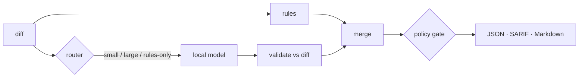
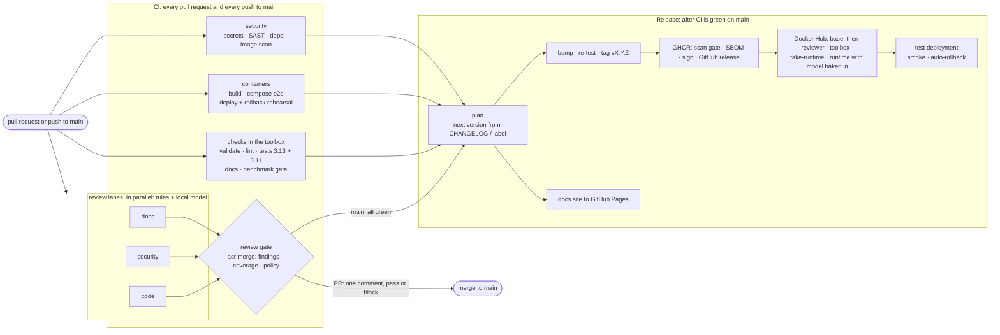

# ai-code-reviewers

Free, open-source, offline code review with small and large **local** language models,
deterministic rules, and policy-driven quality gates. Docker-native; no paid APIs, no
telemetry, no source code leaves your machine.

- **Rules + models.** Deterministic rules (with self-testing examples) set a recall floor that
  prompt injection cannot talk away; local models (Ollama, llama.cpp, any CLI) add hypotheses.
- **Honest output.** Every finding has location, severity, explanation, evidence (secrets
  redacted), remediation, confidence (`low`/`medium`/`high`), and `verified` vs `hypothesis`.
  A minimum confidence (policy default `low`; `--min-confidence` or `ACR_MIN_CONFIDENCE`
  overrides it) filters what is reported and gated, and says what it hid
  ([confidence levels](docs/usage/customize.md#confidence-levels)). JSON, SARIF 2.1.0,
  Markdown, and a legacy text protocol.
- **Degrades, never lies.** If the model runtime is down, reviews fall back to rules and say
  `degraded` everywhere; strict policies fail instead.
- **Traceable.** Results record profile, policy version, skill versions, model id/ref/digest,
  routing decisions, source revision and every recovery action.

Documentation: **https://munafsheikh.github.io/ai-code-reviewers/**
([getting started](docs/usage/getting-started.md) · [examples](docs/usage/examples.md) ·
[customize](docs/usage/customize.md) · [prove your code stays local](docs/usage/privacy.md)).

## Quick start

Only Docker is required, and only the pulls use the network.

```bash
# Rules only: seconds, and the container has no network interface at all
git diff main... | docker run --rm -i --read-only --network none \
  munafsheikh/ai-code-reviewers:0.8.0 review --profile offline

# With the local model: the runtime image has the weights baked in and sits on a network with no route out
docker network create --internal acr
docker run -d --name llm-runtime --network acr --read-only --tmpfs /tmp munafsheikh/ai-code-reviewers-runtime:0.8.0
git diff main... | docker run --rm -i --read-only --network acr -e ACR_MODEL_HOST=http://llm-runtime:11434 \
  munafsheikh/ai-code-reviewers:0.8.0 review --profile balanced
```

Exit codes: `0` pass/warn, `1` blocked, `2` could not review (strict policy, bad input). From a
checkout, `docker compose --profile model up -d --build` / `docker compose down` run the same
stack, and `docker compose run --rm dev review-offline --diff change.patch` reviews a patch file. Step-by-step, the HTTP service and CI setup:
[getting started](docs/usage/getting-started.md).

### Review a GitHub issue (refinement stage)

```bash
gh issue view 42 --json number,title,body,labels,url | acr review --issue - --profile offline
```

The issue is checked against a Definition of Ready (acceptance criteria, reproducible bug
reports, no placeholders, no screenshot-only descriptions) by the same rules, model and gate.
See [lifecycle artifacts](docs/development/extending.md#lifecycle-artifacts).

## How it works



| Concept | Where | Reference |
|---|---|---|
| Skills (rules + prompts): code categories, `documentation`, `refinement` | `skills/` | [catalog](docs/generated/skills.md) · [categories & coverage](docs/development/extending.md#categories-and-coverage) |
| Models: 18 manifests, 11 families, no weights | `models/registry/` | [catalog](docs/generated/models.md) · [selection guide](docs/operations/model-selection.md) |
| Profiles `fast · balanced · deep · laptop · gpu · offline · legacy` | `profiles/` | [profiles & policies](docs/generated/profiles.md) |
| Policies (gate, model trust, baseline) | `policies/` | [profiles & policies](docs/generated/profiles.md) |
| Wrappers (runtime adapters) | `wrappers/` | [custom wrappers](wrappers/custom/README.md) |
| Contracts | `orchestrator/schemas/` | [schemas](docs/generated/schemas.md) |
| CLI / env | `orchestrator/cli/` | [CLI](docs/generated/cli.md) · [configuration](docs/generated/configuration.md) |

Architecture: [overview](docs/architecture/overview.md) · Operations: [runbook](docs/operations/runbook.md),
[troubleshooting](docs/operations/troubleshooting.md) · Security: [threat model](docs/security/threat-model.md),
[vulnerability baseline](docs/security/vulnerability-baseline.md) · Development: [extending](docs/development/extending.md),
[implementation log](docs/development/phase-log.md)

## Your code stays local

The reviewer is stdlib-only Python with an egress allowlist; the model runtime has its
weights baked in and Ollama's cloud features off; both run on a Docker `--internal` network.
`docker compose run --rm dev prove-offline` demonstrates it on your machine: it probes from inside both containers
that nothing can connect out or resolve names, then completes a model review anyway.
Details and manual checks: [prove your code stays local](docs/usage/privacy.md).

## Customize

Team instructions for the model (`/etc/acr/instructions.d/*.md`, `--instructions FILE`,
`$ACR_INSTRUCTIONS`), your own deterministic rules (`/etc/acr/skills.d`), baked into an image
`FROM munafsheikh/ai-code-reviewers` or mapped in with Compose:
[customize reviews](docs/usage/customize.md), with ready examples in
[`examples/custom-image`](examples/custom-image) and [`examples/compose`](examples/compose/compose.yaml).

## Pipeline

Every pull request and push to `main` runs the checks and this project's own review in three
parallel lanes (code, security, docs) merged into one gate; a green `main` then releases,
publishes the images, deploys a test environment and the documentation site automatically.
[Details](docs/architecture/pipeline.md).



## Images

One multi-stage [`Dockerfile`](infrastructure/docker/Dockerfile); derived images are layered on the
published base digest, so they share its layers. Published to Docker Hub (amd64 + arm64, signed,
SBOM + provenance) by the [`Images`](.github/workflows/images.yml) workflow: `edge`/`sha-*` from green
`main`, `X.Y.Z`/`X.Y`/`latest` on release.

| Image | Target | Adds |
|---|---|---|
| `munafsheikh/ai-code-reviewers-base` | `base` | python slim, non-root `acr` (10001) |
| `munafsheikh/ai-code-reviewers` | `reviewer` | application; pip removed |
| `munafsheikh/ai-code-reviewers-toolbox` | `toolbox` | git + pinned dev tooling |
| `munafsheikh/ai-code-reviewers-fake-runtime` | `fake-runtime` | deterministic model runtime for e2e |
| `munafsheikh/ai-code-reviewers-runtime` | `runtime` | Ollama (CPU) with `qwen2.5-coder:1.5b` baked in; not layered on base. `runtime-gpu`: full Ollama image (build it yourself) |

`docker compose run --rm dev images` builds the four Python images locally;
`docker compose run --rm dev runtime --models "..."` builds a runtime with the models you choose (the one build step that downloads weights). Publishing needs `DOCKERHUB_USERNAME` / `DOCKERHUB_TOKEN`
secrets (optional `DOCKERHUB_NAMESPACE` variable).

## CI/CD integrations

| Platform | Adapter |
|---|---|
| GitHub Actions | [`integrations/github`](integrations/github/README.md) — composite action, PR comment, SARIF, gate |
| Azure DevOps | [`integrations/azure-devops/azure-pipelines.yml`](integrations/azure-devops/azure-pipelines.yml) |
| GitLab | [`integrations/gitlab/acr.gitlab-ci.yml`](integrations/gitlab/acr.gitlab-ci.yml) |
| Firefly | [`integrations/firefly`](integrations/firefly/README.md) — replaces `ReviewGate.java`, legacy-compatible |

All adapters run the same image and the same commands, so behaviour is identical across CI
systems.

## Development

```bash
docker compose run --rm dev ci              # validate · lint · tests (coverage gate) · docs check · benchmark gate
docker compose run --rm dev help            # every task
docker compose run --rm dev shell           # interactive toolbox shell
docker compose run --rm dev e2e             # Compose end-to-end with a deterministic fake runtime
docker compose run --rm dev prove-offline   # isolation proof: no route out, model review still works
docker compose run --rm dev docs-site       # documentation site (MkDocs) into out/site
docker compose run --rm dev security        # gitleaks · semgrep · hadolint · trivy (fs, image) · SBOM
```

Docker is the only host requirement. The `dev` service is the `toolbox` image running
[`infrastructure/tasks.py`](infrastructure/tasks.py): each task is a native command (Python
CLIs, pytest, ruff, mkdocs) in the container, or drives the host's Docker through its socket
to build and run the product images. CI runs exactly these commands. Merging to `main` releases automatically: see
[releases](docs/operations/runbook.md#releases).

See [CONTRIBUTING.md](CONTRIBUTING.md) and [SECURITY.md](SECURITY.md). Licensed under MIT;
model weights are baked into the runtime image under their own licenses (recorded per manifest).

<sub>For AI coding agents: [agent guide](AGENTS.md).</sub>
