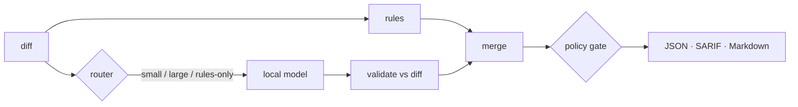

# ai-code-reviewers

Free, open-source, offline code review with small and large **local** language models,
deterministic rules, and policy-driven quality gates. Docker-native; no paid APIs, no
telemetry, no source code leaves your machine.

- **Rules + models.** Deterministic rules (with self-testing examples) set a recall floor that
  prompt injection cannot talk away; local models (Ollama, llama.cpp, any CLI) add hypotheses.
- **Honest output.** Every finding has location, severity, explanation, evidence (secrets
  redacted), remediation, confidence, and `verified` vs `hypothesis`. JSON, SARIF 2.1.0,
  Markdown, and a legacy text protocol.
- **Degrades, never lies.** If the model runtime is down, reviews fall back to rules and say
  `degraded` everywhere; strict policies fail instead.
- **Traceable.** Results record profile, policy version, skill versions, model id/ref/digest,
  routing decisions, source revision and every recovery action.

## Quick start

```bash
# 1. Rules only — no containers, no downloads (Python ≥ 3.11, stdlib only)
python3 -m orchestrator review --profile offline --diff examples/sample-repo/change.patch

# 2. Full stack: reviewer + Ollama + qwen2.5-coder:1.5b, health-checked
make up
git diff main... | docker compose run --rm -T reviewer review          # single command review
curl -s --data-binary @examples/sample-repo/change.patch 127.0.0.1:8088/v1/review
make down
```

Exit codes: `0` pass/warn, `1` blocked, `2` could not review (strict policy, bad input).

## How it works



| Concept | Where | Reference |
|---|---|---|
| Skills (rules + prompts) | `skills/` | [catalog](docs/generated/skills.md) |
| Models (manifests, no weights) | `models/registry/` | [catalog](docs/generated/models.md) |
| Profiles `fast · balanced · deep · offline · legacy` | `profiles/` | [profiles & policies](docs/generated/profiles.md) |
| Policies (gate, model trust, baseline) | `policies/` | [profiles & policies](docs/generated/profiles.md) |
| Wrappers (runtime adapters) | `wrappers/` | [custom wrappers](wrappers/custom/README.md) |
| Contracts | `orchestrator/schemas/` | [schemas](docs/generated/schemas.md) |
| CLI / env | `orchestrator/cli/` | [CLI](docs/generated/cli.md) · [configuration](docs/generated/configuration.md) |

Architecture: [overview](docs/architecture/overview.md) · Operations: [runbook](docs/operations/runbook.md),
[troubleshooting](docs/operations/troubleshooting.md) · Security: [threat model](docs/security/threat-model.md),
[vulnerability baseline](docs/security/vulnerability-baseline.md) · Development: [extending](docs/development/extending.md),
[implementation log](docs/development/phase-log.md)

## CI/CD integrations

| Platform | Adapter |
|---|---|
| GitHub Actions | [`integrations/github`](integrations/github/README.md) — composite action, PR comment, SARIF, gate |
| Azure DevOps | [`integrations/azure-devops/azure-pipelines.yml`](integrations/azure-devops/azure-pipelines.yml) |
| GitLab | [`integrations/gitlab/acr.gitlab-ci.yml`](integrations/gitlab/acr.gitlab-ci.yml) |
| Firefly | [`integrations/firefly`](integrations/firefly/README.md) — replaces `ReviewGate.java`, legacy-compatible |

All adapters run the same image and the same commands as `make`, so behaviour is identical
across CI systems.

## Development

```bash
make dev && make ci      # validate · lint · tests (coverage gate) · docs check · benchmark gate
make e2e                 # Compose end-to-end with a deterministic fake runtime
make security            # gitleaks · semgrep · hadolint · trivy (fs, image) · SBOM
```

See [CONTRIBUTING.md](CONTRIBUTING.md) and [SECURITY.md](SECURITY.md). Licensed under MIT;
model weights are downloaded by the runtime under their own licenses (recorded per manifest).
