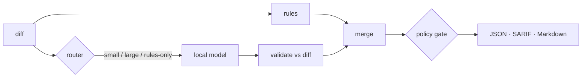

# ai-code-reviewers

Free, open-source, offline code review with small and large **local** language models,
deterministic rules, and policy-driven quality gates. Container-native (Podman); no paid APIs, no
telemetry, no source code leaves your machine.

- **Rules + models.** Deterministic rules (with self-testing examples) set a recall floor that
  prompt injection cannot talk away; local models (Ollama, llama.cpp, any CLI) add hypotheses.
- **Honest output.** Every finding has location, severity, explanation, evidence (secrets
  redacted), remediation, confidence, and `verified` vs `hypothesis`. JSON, SARIF 2.1.0,
  Markdown, and a legacy text protocol.
- **Degrades, never lies.** If the model runtime is down, reviews fall back to rules and say
  `degraded` everywhere; strict policies fail instead.
- **Traceable.** Results record profile, policy version, skill versions, model id/ref/digest,
  routing decisions, source revision and every recovery action.

## Quick start

Only Podman is required (`podman compose` with docker-compose as its provider). Every tool
(reviewer, tests, linters, scanners, docs) runs in a pinned container image and pulls its own
dependencies.

```bash
# 1. Rules only — no model download (PowerShell: ./run.ps1)
./run.sh review-offline --diff examples/sample-repo/change.patch

# 2. Full stack: reviewer + Ollama + qwen2.5-coder:1.5b, health-checked
podman compose --profile model up -d --build --wait
git diff main... | podman compose run --rm -T reviewer review          # single command review
curl -s --data-binary @examples/sample-repo/change.patch 127.0.0.1:8088/v1/review
podman compose --profile model down
```

Exit codes: `0` pass/warn, `1` blocked, `2` could not review (strict policy, bad input).

### Review a GitHub issue (refinement stage)

```bash
gh issue view 42 --json number,title,body,labels,url | acr review --issue - --profile offline
```

The issue is checked against a Definition of Ready (acceptance criteria, reproducible bug
reports, no placeholders, no screenshot-only descriptions) by the same rules, model and gate.
See [lifecycle artifacts](docs/development/extending.md#lifecycle-artifacts).

## How it works



| Concept | Where | Reference |
|---|---|---|
| Skills (rules + prompts): code categories, `documentation`, `refinement` | `skills/` | [catalog](docs/generated/skills.md) · [categories & coverage](docs/development/extending.md#categories-and-coverage) |
| Models: 18 manifests, 11 families, no weights | `models/registry/` | [catalog](docs/generated/models.md) · [selection guide](docs/operations/model-selection.md) |
| Profiles `fast · balanced · deep · laptop · gpu · offline · legacy` | `profiles/` | [profiles & policies](docs/generated/profiles.md) |
| Policies (gate, model trust, baseline) | `policies/` | [profiles & policies](docs/generated/profiles.md) |
| Wrappers (runtime adapters) | `wrappers/` | [custom wrappers](wrappers/custom/README.md) |
| Contracts | `orchestrator/schemas/` | [schemas](docs/generated/schemas.md) |
| CLI / env | `orchestrator/cli/` | [CLI](docs/generated/cli.md) · [configuration](docs/generated/configuration.md) |

Architecture: [overview](docs/architecture/overview.md) · Operations: [runbook](docs/operations/runbook.md),
[troubleshooting](docs/operations/troubleshooting.md) · Security: [threat model](docs/security/threat-model.md),
[vulnerability baseline](docs/security/vulnerability-baseline.md) · Development: [extending](docs/development/extending.md),
[implementation log](docs/development/phase-log.md)

## Images

One multi-stage [`Dockerfile`](infrastructure/docker/Dockerfile); derived images are layered on the
published base digest, so they share its layers. Published to Docker Hub (amd64 + arm64, signed,
SBOM + provenance) by the [`Images`](.github/workflows/images.yml) workflow: `edge`/`sha-*` from green
`main`, `X.Y.Z`/`X.Y`/`latest` on release.

| Image | Target | Adds |
|---|---|---|
| `munafsheikh/ai-code-reviewers-base` | `base` | python slim, non-root `acr` (10001) |
| `munafsheikh/ai-code-reviewers` | `reviewer` | application; pip removed |
| `munafsheikh/ai-code-reviewers-toolbox` | `toolbox` | git + pinned dev tooling |
| `munafsheikh/ai-code-reviewers-fake-runtime` | `fake-runtime` | deterministic model runtime for e2e |

`podman compose --profile build --profile tools --profile test build` builds all four locally
(`acr-base:local`, `acr-reviewer:local`, `acr-toolbox:local`, `acr-fake-runtime:local`). Publishing needs `DOCKERHUB_USERNAME` / `DOCKERHUB_TOKEN`
secrets (optional `DOCKERHUB_NAMESPACE` variable).

## CI/CD integrations

| Platform | Adapter |
|---|---|
| GitHub Actions | [`integrations/github`](integrations/github/README.md) — composite action, PR comment, SARIF, gate |
| Azure DevOps | [`integrations/azure-devops/azure-pipelines.yml`](integrations/azure-devops/azure-pipelines.yml) |
| GitLab | [`integrations/gitlab/acr.gitlab-ci.yml`](integrations/gitlab/acr.gitlab-ci.yml) |
| Firefly | [`integrations/firefly`](integrations/firefly/README.md) — replaces `ReviewGate.java`, legacy-compatible |

All adapters run the same image and the same review command, so behaviour is identical
across CI systems.

## Development

```bash
./run.sh ci                              # validate · lint · tests (coverage gate) · docs check · benchmark gate, in the toolbox image
./run.sh -h                              # every repository task
podman compose run --rm toolbox bash     # interactive toolbox shell
tests/end-to-end/compose_e2e.sh          # Compose end-to-end with a deterministic fake runtime
infrastructure/scripts/security-scan.sh  # gitleaks · semgrep · hadolint · trivy (fs, image) · SBOM
```

Podman is the only host requirement. `compose.yaml` builds every image; `./run.sh` and
`./run.ps1` start the `toolbox` service, where every repository task runs
([`tasks.py`](infrastructure/scripts/tasks.py)); the stack, end-to-end, security and deployment
scripts call `podman` and `podman compose` directly. CI runs the same commands. Merging to `main` releases automatically: see
[releases](docs/operations/runbook.md#releases).

See [CONTRIBUTING.md](CONTRIBUTING.md) and [SECURITY.md](SECURITY.md). Licensed under MIT;
model weights are downloaded by the runtime under their own licenses (recorded per manifest).

<sub>For AI coding agents: [agent guide](AGENTS.md).</sub>
