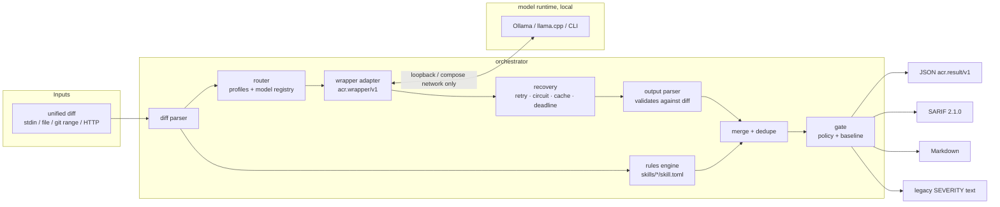
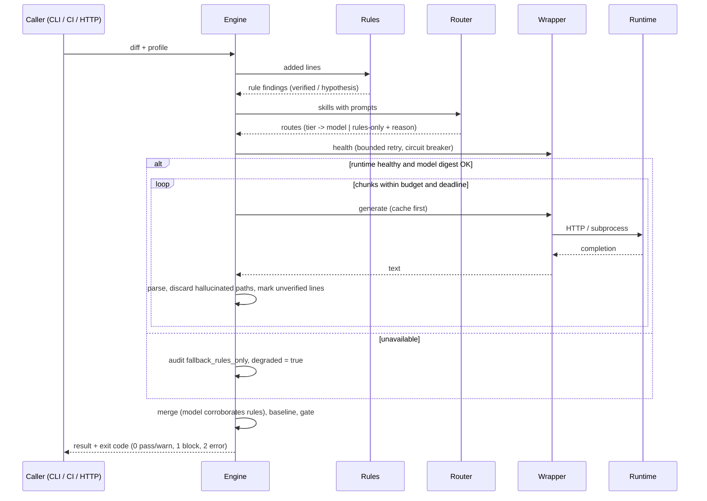
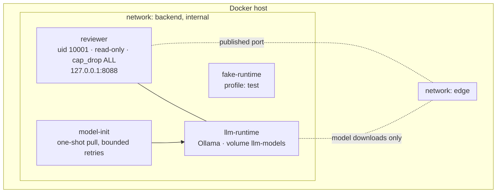

# Architecture

## Components

| Layer | Path | Contract |
|---|---|---|
| Models | `models/registry/*.toml` | `acr.model/v1` — identity, source, license, digest, context, resources |
| Skills | `skills/**/skill.toml` (+ `prompt.md`) | `acr.skill/v1` — deterministic rules with self-test examples, optional model prompt and tier |
| Wrappers | `wrappers/*/wrapper.toml` (+ `adapter.py`) | `acr.wrapper/v1` — `health()`, `generate()`; declared permissions statically enforced |
| Profiles | `profiles/*/profile.toml` | routing, budgets, retry, circuit, cache, generation settings |
| Policies | `policies/review/*.toml` | gate thresholds, model trust, infrastructure-failure behaviour, baseline |
| Results | `orchestrator/schemas/review-result.schema.json` | `acr.result/v1` |

Reference tables generated from these sources: [skills](../generated/skills.md),
[models](../generated/models.md), [profiles and policies](../generated/profiles.md),
[schemas](../generated/schemas.md), [CLI](../generated/cli.md), [environment](../generated/configuration.md).

## Review flow

## Design decisions

| Decision | Rationale |
|---|---|
| Python stdlib-only runtime | No third-party runtime dependencies → minimal supply-chain surface; image is ~178 MB with pip removed. |
| Rules + models, never models alone | Rules give a deterministic recall floor and cannot be talked out of a finding by prompt injection; models add hypotheses. |
| Model findings are always `hypothesis` | Probabilistic output is labelled as such; only high-confidence rule matches are `verified`. |
| Findings must cite a file in the diff | Hallucinated paths are discarded; out-of-hunk lines are kept at `low` confidence with `location.verified = false`. |
| Degrade, don't fail, by default | An unavailable model must not block delivery; the `strict` policy opts into failing (exit 2). Degradation is always reported. |
| TOML manifests + JSON Schema | Human-editable, comment-friendly, parsed by `tomllib`; schemas are published and cross-checked with `jsonschema` in tests. |
| Legacy profile | Byte-identical prompt and wire payload, same stdout and exit codes as Firefly's `ReviewGate.java` (regression-tested). |
| Wrappers loaded from manifests | Hyphenated directories (`llama-cpp`), drop-in custom wrappers, and static permission checks before load. |

## Deployment topology

The `backend` network is `internal: true`. Wrapper egress is additionally restricted in
code to loopback, compose service names and `ACR_ALLOWED_HOSTS`, with proxies bypassed.
