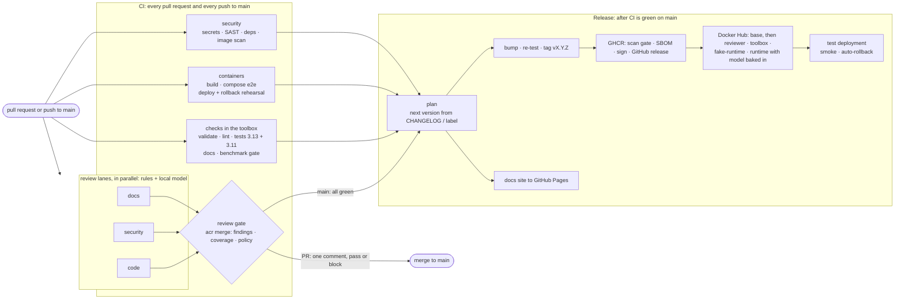

# CI/CD pipeline

Every change goes through the same path: checks and the project's own review in parallel,
one gate, then (on `main`) an automatic release, image publishing, a test deployment and
the documentation site. Repository logic in the workflows is a `make` target or this
repository's own action, so each step runs in the same containers locally and in CI.



## CI (`.github/workflows/ci.yml`): every pull request and every push to `main`

| Job | What it proves |
|---|---|
| `test` | `make validate lint test docs-check bench-gate` in the toolbox: manifests and rule examples, lint, tests with coverage gate, generated docs current, benchmark precision/recall |
| `python-compat` | the same tests in a toolbox built on Python 3.11, the minimum supported |
| `container` | the reviewer image builds and runs read-only; Compose end-to-end with the fake runtime; a deploy with automatic rollback is rehearsed |
| `security` (`security.yml`) | secrets, SAST, dependency and image scans; SBOM diff against the base branch |
| `review (code)`, `review (security)`, `review (docs)` | this project reviewing its own change, **in parallel**: each lane runs rules plus a real local model on its skill set (`--skills`) |
| `review-gate` | merges the three lanes (`acr merge`): findings de-duplicated, coverage judged across lanes (a file no lane covered blocks), one PR comment, one gate; also fails if the model did not run |

Pull requests are reviewed against their base branch; pushes to `main` against the previous
tip, so nothing reaches a release without having been reviewed.

## Release (`.github/workflows/release.yml`): after CI is green on `main`

Release starts only when the whole CI run, review gate included, succeeded.

1. **plan**: `make release-plan` reads the CHANGELOG `[Unreleased]` section (Added/Changed
   → minor, Fixed/Security → patch, Removed or BREAKING → major) or a `release:*` label on
   the merged PR; nothing to release stops here (docs are still published).
2. **bump**: `make release-apply` writes the version everywhere, `make ci` re-tests the
   bumped tree, then `Release X.Y.Z` and tag `vX.Y.Z` are pushed to `main` together.
3. **publish**: scan gate, SBOM, signed and attested reviewer image on GHCR, GitHub release.
4. **images** (`images.yml`): the base image first, then reviewer, toolbox, fake-runtime
   layered on its digest, plus the model runtime with the weights baked in; multi-arch,
   signed, to Docker Hub as `X.Y.Z`, `X.Y` and `latest`.
5. **deploy** (`deploy.yml`): the previous release, then the candidate, into a disposable
   environment; smoke-tested, rolled back automatically if unhealthy.
6. **docs** (`pages.yml`): `make docs-site` (MkDocs, strict) published to GitHub Pages,
   built from the release commit when a version was cut.

Every green `main` also publishes `edge` and `sha-<12>` images (`images.yml`).

## Run the same steps locally

```bash
make ci                 # what the test job runs
make e2e                # compose end-to-end
make release-plan       # what the next release would be
make docs-site          # the documentation site, into out/site
make prove-offline      # the isolation proof (see "Prove your code stays local")
```
