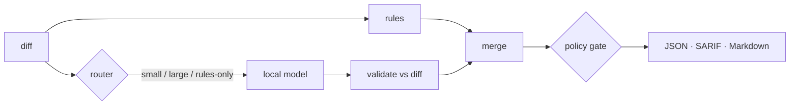
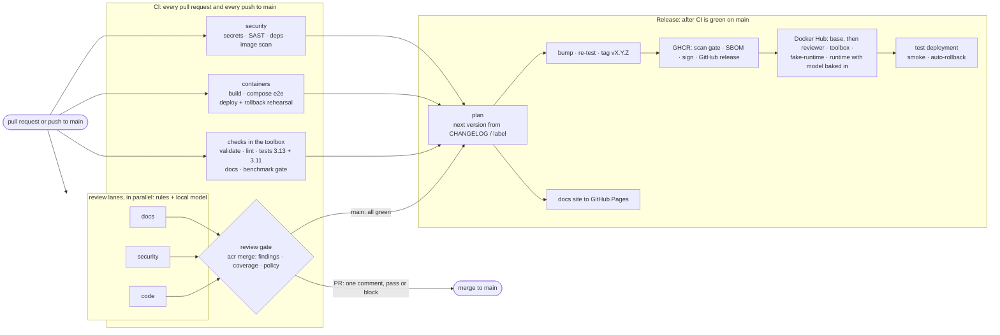

# ai-code-reviewers

Free, open-source, offline code review with local language models, deterministic rules and
policy-driven quality gates. Everything runs in containers on your machine or your CI runner:
no paid APIs, no telemetry, and the code under review never leaves the machine.

```bash
git diff main... | docker run --rm -i --read-only --network none \
  munafsheikh/ai-code-reviewers:0.10.0 review --profile offline
```

| Start here | |
|---|---|
| [Getting started](usage/getting-started.md) | Step by step: pull the images, first review, add the local model, Compose, HTTP service, CI |
| [Code review examples](usage/examples.md) | Real changes and exactly what the reviewer reports |
| [Customize reviews](usage/customize.md) | Team instructions at run time, your own rules, your own image, other models |
| [Prove your code stays local](usage/privacy.md) | What enforces it and `docker compose run --rm dev prove-offline` to check it yourself |
| [CI/CD pipeline](architecture/pipeline.md) | Parallel review lanes, one gate, automatic release and deployment |

## How a review works

Deterministic rules (with self-testing examples) set a recall floor that a diff cannot talk
away; a local model adds findings, clearly marked as hypotheses; a policy decides what
blocks. If the model is unavailable the review says `degraded` and falls back to the rules.



## How this project ships


