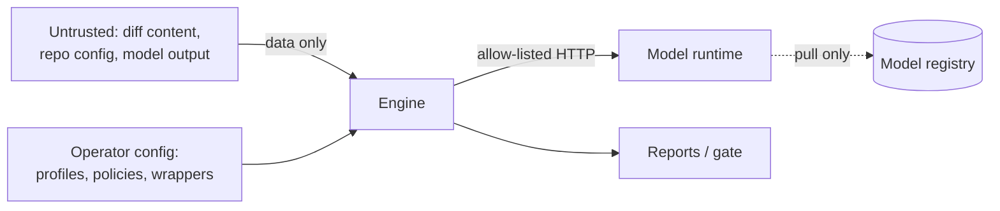

# Threat model

Scope: the reviewer (engine, wrappers, HTTP service, container), the model runtime, CI adapters.

## Assets
Source code under review · CI credentials of consumers · integrity of the gate decision ·
integrity of released images · the host running the stack.

## Trust boundaries

## Threats and controls

| # | Threat (STRIDE) | Control | Verified by |
|---|---|---|---|
| T1 | Prompt injection in code/comments flips the verdict (T) | Diff fenced as data; fence-closing tags neutralised; deterministic rules can block regardless of model output; model findings are hypotheses | `tests/security/test_untrusted_input.py`, fixture `prompt-injection` |
| T2 | Model hallucinates files/lines (T) | Findings for files not in the diff discarded; out-of-hunk lines marked unverified and low confidence | `test_model_cannot_invent_findings_outside_the_diff` |
| T3 | Source code exfiltration (I) | Egress allowlist in code, proxies bypassed, `backend` network `internal: true`, no telemetry | `test_egress_*`, `test_proxy_environment_is_ignored_by_default` |
| T4 | Repo-controlled git config executes commands (E) | `--no-textconv --no-ext-diff`, `core.fsmonitor=false`, hooks disabled; image ships without git | `test_git_range_does_not_execute_repo_controlled_textconv` |
| T5 | Secrets echoed into reports/PR comments (I) | Evidence redaction for common secret shapes in all formats | `test_secrets_are_redacted_in_every_output_format` |
| T6 | Malicious/over-privileged wrapper (E) | Manifest-declared permissions, AST check of imports/calls, no auto-install | `acr validate`, `test_permission_checker_detects_violations` |
| T7 | Tampered or swapped model (T) | Manifest digest compared with runtime digest; mismatch disables the model; strict policy requires pins | `test_model_digest_mismatch_disables_model` |
| T8 | DoS via huge diffs or request floods (D) | Body limit (413), concurrency limit (429), file/char/call budgets, deadlines, circuit breaker | `test_service_rejects_oversized_and_unknown_profiles`, `test_model_call_budget_is_enforced` |
| T9 | Container escape / host impact (E) | uid 10001, read-only rootfs, `cap_drop: ALL`, `no-new-privileges`, loopback-only port, resource limits | `tests/end-to-end/compose_e2e.sh` |
| T10 | Supply chain (T) | Stdlib-only runtime; actions pinned by SHA, images by digest (`check_pins.py`); SBOM + SBOM diff; trivy gate; cosign keyless signing; Dependabot | `security.yml`, `release.yml` |
| T11 | Silent weakening of gates (R) | Baseline/trivy exceptions need reason, owner, expiry; expired ones fail `check_exceptions.py`; CODEOWNERS on `policies/` and fixtures; fixture checksums | `validate`, `scheduled.yml` |
| T12 | Corrupted cache returns attacker content (T) | Content-addressed, sha256-verified entries; atomic writes; corrupt entries evicted | `test_cache_roundtrip_and_corruption_self_heals` |

## Residual risks
- The completion cache stores model output, which can quote reviewed code; it lives in the same
  trust domain as the code (local volume). Do not share cache volumes across tenants.
- Regex rules can miss obfuscated defects; they are a floor, not a proof of absence.
- Ollama runs as root inside its container (upstream image); mitigated by dropped capabilities
  and read-only rootfs.

Reassess quarterly or on any new wrapper, network path or privilege change (Level 4).
